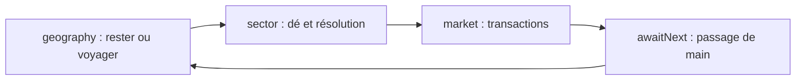

# Audit du moteur, des données et du multijoueur

État relevé le **12 octobre 2026**, avant toute modification fonctionnelle de cette itération. Les chiffres ci-dessous sont recomptés depuis les fichiers utilisés par le moteur, puis recoupés avec les tests.

Ce document conserve le relevé initial. Les positions et effets Bull/Bear décrits ici ont ensuite été remplacés par les règles détaillées dans [ENGINE_RULES.md](ENGINE_RULES.md), où Bear occupe désormais la case 40.

## 1. Projet actif et périmètre

- Projet : `/home/codex/projects/global-fund-evolve`, anciennement `global-fund-next-new`.
- Branche locale : `global-fund-evolve`, basée sur `58493e0e805820a9c5ea29d39dad4c9229afceb2` (PR #1), avec les adaptations locales de nom et de mise en ligne déjà présentes avant cet audit.
- Production : `/home/codex/deployments/global-fund-evolve/current`, vers la release `20261011T191339Z-58493e0-online` ; service `global-fund-evolve.service`, port 3102, base PostgreSQL `global_fund_evolve`.
- URL : <https://global-fund-evolve.213.199.40.67.sslip.io>.
- Archive V2 : `/home/codex/projects/global-fund-next`. Elle ne fait pas partie des modifications de cette itération.

Cette étape produit uniquement ce document. Elle ne change ni règles, ni données, ni lobby, ni rendu, ni styles. Les modifications locales préexistantes sont conservées ; aucun déploiement ni redémarrage n'est effectué.

## 2. Cartographie des fichiers concernés

Le dépôt est un monorepo npm : `apps/*` et `packages/*` sont des workspaces. Node.js ≥ 22.12 est requis.

| Domaine | Fichiers actifs | Responsabilité |
|---|---|---|
| API du moteur | [packages/game-engine/src/index.ts](packages/game-engine/src/index.ts) | `createGame`, `executeCommand`, `getGameView`, calculs exposés, `getDecisionPlayerId`, `chooseAiCommand`, `simulateGames` |
| Règles et transitions | [packages/game-engine/legacy/game.cjs](packages/game-engine/legacy/game.cjs) | État métier, dés, phases, déplacements, revenus, détention, règlements, insolvabilité et fin |
| Plateau logique, entreprises, Contextes | [packages/game-engine/legacy/data/gameData.json](packages/game-engine/legacy/data/gameData.json) | Référentiel réellement chargé : `zones`, `sectors`, `companies`, `events` (Contextes), `board` |
| Événements de case | [packages/game-engine/legacy/boardEventCards.cjs](packages/game-engine/legacy/boardEventCards.cjs) | 50 cartes, effets, montants, quantités, secteurs cibles et récits |
| Récits de Contexte | [packages/game-engine/legacy/eventStories.cjs](packages/game-engine/legacy/eventStories.cjs) | Templates et formulations raccordés aux changements d'indices |
| Paramètres économiques | [packages/game-engine/src/economy.ts](packages/game-engine/src/economy.ts) | Seuils Small/Medium/Large, scénarios, `capCategoryFor`, `normalizeEconomy` |
| Contrats et marchés | [packages/shared/src/index.ts](packages/shared/src/index.ts), [markets.ts](packages/shared/src/markets.ts) | Types d'état/commande/salon/session, cinq marchés, compatibilité des anciennes nationalités et répartition des IA |
| Serveur multijoueur | [apps/server/src/server.ts](apps/server/src/server.ts), [index.ts](apps/server/src/index.ts) | Fastify, Socket.IO, salons, contrôleurs, révisions, commandes, IA et persistance |
| Stockage et migration | [schema.ts](apps/server/src/schema.ts), [migrate.ts](apps/server/src/migrate.ts), [0000_rooms.sql](apps/server/migrations/0000_rooms.sql) | Table `rooms` avec état JSONB ; migration idempotente |
| Création et lobby | [apps/web/src/App.tsx](apps/web/src/App.tsx), [setupDraft.ts](apps/web/src/setupDraft.ts) | Configuration des places, marchés, invitations, état prêt et lancement |
| Connexion client | [apps/web/src/store.ts](apps/web/src/store.ts) | Session locale, émissions Socket.IO, reprise, snapshots et file de présentation |
| Plateau graphique, lecture seule | [BoardScene.tsx](apps/web/src/board/BoardScene.tsx), [three/Scene.tsx](apps/web/src/board/three/Scene.tsx), [three/layout.ts](apps/web/src/board/three/layout.ts), [three/atlas.ts](apps/web/src/board/three/atlas.ts) | Présentation du plateau reçu du serveur ; aucun calcul de règle à déplacer ici |
| Présentation des cartes, lecture seule | [presentation/sequence.ts](apps/web/src/presentation/sequence.ts), [CardScene.tsx](apps/web/src/presentation/CardScene.tsx), [game/GameWorld.tsx](apps/web/src/game/GameWorld.tsx) | Lecture et animation d'un résultat déjà décidé par le serveur |
| Équilibrage et simulation | [scripts/balance-economy.ts](scripts/balance-economy.ts), [scripts/simulate.ts](scripts/simulate.ts), [ECONOMY_BALANCING.md](ECONOMY_BALANCING.md) | Campagnes reproductibles, rapports et limites des mesures |

Le catalogue des entreprises est embarqué dans `gameData.json` ; aucun catalogue `companies.enriched.json` distinct n'est présent dans ce checkout. Les audits [COMPANY_AUDIT.md](COMPANY_AUDIT.md), [MARKET_DISTRIBUTION.md](MARKET_DISTRIBUTION.md) et [EVENT_CARD_AUDIT.md](EVENT_CARD_AUDIT.md) sont des documents complémentaires.

## 3. Architecture et état du moteur

La façade TypeScript charge le noyau CommonJS local via `createRequire`. Le moteur ne dépend ni du DOM, ni de React, ni du réseau, ni de la base. `executeCommand` valide les champs autorisés puis travaille sur un `structuredClone` : l'état d'entrée reste intact, même si une action est refusée. `getGameView` retourne une copie détachée sans les paquets futurs ni les bases d'acquisition internes.

Les 13 commandes publiques couvrent implantation (`STAY`, `MOVE`), dés (`ROLL`, `PRISON_ROLL`), achats/ventes, fin et passage de tour, liquidation et négociation des règlements. Aucun champ de dé imposé n'est accepté. Les résultats aléatoires et les transitions restent côté serveur.

L'état conserve joueurs, entreprises avec participations/PRU, plateau, indices de zone/secteur, paquets, défausse Événement, cycle, ordre, notifications, historiques et éventuel règlement en attente. Les phases ordinaires sont :

L'ouverture du **cycle 1** commence directement en `sector`, avec **100 M€ par fonds**, tous les indices à **C**, marché initial gratuit et aucun Contexte révélé. Dès le cycle 2, un Contexte collectif ouvre le tour de table, puis chaque fonds choisit son implantation avant son dé. Voyager coûte 1 M€ ; rester est gratuit. `settlement` suspend une obligation pour obtenir une décision, dont l'acteur peut être un créancier autre que le joueur actif. `finished` clôt la partie.

Le dé d'initiative choisit le premier fonds une seule fois, avec relances entre ex æquo. L'ordre circulaire des places demeure fixe entre cycles ; les insolvables sont sautés. La partie se termine après les tours du cycle 101 (100e Contexte), ou plus tôt lorsqu'un seul fonds reste solvable. Références : `createGame`, `roll`, `nextTurn`, `applyAction`, `publicState` dans `legacy/game.cjs` ; façade `src/index.ts`.

## 4. Représentation historique des 52 cases — relevé initial

Les positions et effets de cette section sont ceux **avant la modification Bull/Bear**. Le tableau conserve donc l'ancienne case 39 de Bear ; la position canonique actuelle est **case 40 / indice 39**, dans [ENGINE_RULES.md](ENGINE_RULES.md).

`board` est un tableau ordonné de **52 objets**. `BoardCell.kind` vaut `start`, `sector`, `event` ou `market` ; chaque case possède un `label`, les cases sectorielles un identifiant `sector`. L'indice du tableau est la position métier : `sectorPosition` va de **0 à 51**, et le déplacement est `(position + dé) % board.length`. Le plateau graphique consomme cet ordre.

| Type | Nombre |
|---|---:|
| Départ | 1 |
| Secteur | 38 |
| Événement | 10 |
| Marché Bull / Crash / Bear | 3 |
| **Total** | **52** |

La numérotation ci-dessous est lisible de **1 à 52** ; soustraire 1 pour l'indice moteur. Les noms sectoriels sont abrégés.

| Cases 1–13 | Cases 14–26 | Cases 27–39 | Cases 40–52 |
|---|---|---|---|
| 1 Départ | 14 Bull | 27 Événement | 40 Événement |
| 2 Transports | 15 Immobilier | 28 Transports | 41 Transports |
| 3 Agroalimentaire | 16 Agroalimentaire | 29 Agroalimentaire | 42 Agroalimentaire |
| 4 Événement | 17 Événement | 30 Énergie | 43 Énergie |
| 5 Énergie | 18 Énergie | 31 Événement | 44 Événement |
| 6 Transports | 19 Industrie | 32 Industrie | 45 Industrie |
| 7 Industrie | 20 Médias | 33 Immobilier | 46 Finance |
| 8 Santé | 21 Santé | 34 Santé | 47 Santé |
| 9 Événement | 22 Événement | 35 Finance | 48 Finance |
| 10 Finance | 23 Finance | 36 Événement | 49 Événement |
| 11 Technologie | 24 Technologie | 37 Technologie | 50 Technologie |
| 12 Médias | 25 Médias | 38 Immobilier | 51 Technologie |
| 13 Immobilier | 26 Crash | 39 Bear | 52 Médias |

Franchir Départ compare la NAV courante à celle du précédent passage, en neutralisant les flux de capital : +20 M€ si la performance est positive, −20 M€ si elle est négative, aucun flux si elle est nulle. La nouvelle référence est fixée après ce règlement, avant la résolution de la case d'arrivée.

### Distribution sectorielle et chocs de marché

| Secteur métier | Cases | Entreprises |
|---|---:|---:|
| `technology` — Technologie | 5 | 13 |
| `finance` — Finance | 5 | 14 |
| `industry` — Industrie | 4 | 14 |
| `health` — Santé | 4 | 9 |
| `energy` — Énergie | 4 | 11 |
| `realestate` — Immobilier & infrastructures | 4 | 4 |
| `agrifood` — Agroalimentaire & ressources | 4 | 12 |
| `media` — Communication & médias | 4 | 8 |
| `transport` — Transports & logistique | 4 | 6 |
| **Total** | **38** | **91** |

Bull est à l'indice **13** (case 14), Crash à **25** (case 26), Bear à **38** (case 39). Bull améliore les notes d'un niveau, Bear les dégrade d'un niveau, Crash de deux. La portée choisie aléatoirement est **toutes les zones ou tous les secteurs**, avec bornage A–E. Ces cases ne piochent pas d'Événement ; elles recalculent les cours et peuvent déclencher une faillite E/E (`roll`, `game.cjs`, ligne 756).

## 5. Cartes Événement

Les **50 cartes distinctes** viennent de `boardEventCards.cjs`. Leur paquet `boardEventDeck` est mélangé au lancement ; chaque arrivée sur l'une des 10 cases Événement consomme une carte et la place dans `boardEventDiscard`. Lorsque le paquet est épuisé, la défausse est remélangée. Il est indépendant du paquet Contexte.

| Effet | Cartes | Fonctionnement actuel |
|---|---:|---|
| `cash` | 8 | Flux de cash du fonds actif via `activeCash` |
| `dividend` | 8 | Dividende par part aux détenteurs de la société ciblée ; détenus exclus |
| `fine` | 8 | Charge par part pour ses détenteurs |
| `buyback` | 6 | Rachat d'une part par détenteur, au cours avec prime |
| `forcedSale` | 6 | Vente imposée de la quantité indiquée chez les détenteurs |
| `marginCall` | 5 | Obligation du fonds actif s'il possède la cible |
| `prison` | 4 | Détention de l'actif uniquement s'il détient la société ciblée |
| `regulation` | 5 | Ventes imposées sur les positions de monopole du secteur concerné |
| **Total** | **50** | |

`eventTargetCompany` filtre les sociétés disponibles et le secteur éventuel, puis privilégie les titres détenus par l'actif, sinon ceux détenus par quelqu'un, sinon l'ensemble des candidats. Le choix est aléatoire dans ce pool. Le récit remplace `{company}` par le nom retenu ; la notification expose séparément identifiant, entreprise, zone, secteur et effet. Les textes ne décident pas les règles.

`activeCash` s'applique indépendamment de l'effet principal. Les charges peuvent ouvrir un règlement en attente. **Les Événements ne modifient pas les notes économiques ni le paquet Contexte.** Références : `ensureBoardEventDeck`, `eventTargetCompany`, `drawBoardEvent`, `applyRegulation` dans `game.cjs`.

## 6. Cartes Contexte

Les **100 Contextes** sont les entrées `events` de `gameData.json` — ce nom historique ne doit pas être confondu avec les Événements de case.

| Catégorie `type` | Nombre |
|---|---:|
| `positive` | 35 |
| `negative` | 35 |
| `neutral` | 10 |
| `prison` | 10 |
| `regulation` | 10 |

`contextDeck` compose dix blocs mélangés de dix cartes : trois ou quatre positives, trois ou quatre négatives, une neutre, une `prison`, une `regulation`. Cinq blocs ont quatre positives, les cinq autres quatre négatives. Si les effectifs ne correspondent plus à ce schéma, le code revient à un mélange global.

Un seul Contexte est révélé entre deux tours de table, pour les cycles **2 à 101**. `drawContext` applique les notes absolues déclarées dans `changes`, traite les faillites, enregistre les conséquences et l'historique. Les catégories `prison` et `regulation` n'ajoutent **ni arrestation ni vente forcée** : leurs effets restent ceux de `changes`. Le paquet Contexte ne se recycle pas. Références : `contextDeck` (ligne 133), `drawContext` (295), `nextTurn` (839), `eventStories.cjs`.

## 7. Entreprises et capitalisations

Le catalogue contient **91 identifiants uniques**, cinq marchés et neuf secteurs. Une nouvelle partie clone ces entrées, avec cinq parts de 20 % par société. Les sauvegardes gardent leurs sociétés embarquées, leur `basePrice`, leur `baseIncome`, leurs participations et leurs bases d'achat ; consulter une ancienne partie n'importe pas le nouveau catalogue.

| Marché | Small | Medium | Large | Total |
|---|---:|---:|---:|---:|
| Amériques | 2 | 13 | 20 | 35 |
| Europe | 2 | 11 | 11 | 24 |
| Asie | 3 | 5 | 9 | 17 |
| Afrique & Moyen-Orient | 6 | 0 | 0 | 6 |
| Océanie | 7 | 2 | 0 | 9 |
| **Total** | **20** | **31** | **40** | **91** |

| Secteur | Amériques | Europe | Asie | Afrique & M.-O. | Océanie | Total |
|---|---:|---:|---:|---:|---:|---:|
| Technologie | 7 | 1 | 4 | 0 | 1 | 13 |
| Finance | 6 | 2 | 4 | 1 | 1 | 14 |
| Industrie | 5 | 5 | 3 | 0 | 1 | 14 |
| Santé | 2 | 6 | 0 | 0 | 1 | 9 |
| Énergie | 4 | 3 | 2 | 1 | 1 | 11 |
| Immobilier | 0 | 0 | 1 | 2 | 1 | 4 |
| Agroalimentaire | 7 | 4 | 0 | 0 | 1 | 12 |
| Médias | 3 | 1 | 1 | 2 | 1 | 8 |
| Transports | 1 | 2 | 2 | 0 | 1 | 6 |
| **Total** | **35** | **24** | **17** | **6** | **9** | **91** |

Les seuils Global Fund sont **Small < 40 Md USD**, **Medium de 40 à moins de 200 Md USD**, **Large ≥ 200 Md USD**. Ce sont les classes de ce jeu, distinctes des catégories boursières usuelles. `marketCapUSD` sert au classement et à la normalisation ; il n'est pas converti en euros de jeu. Les métadonnées de source/date sont dans le catalogue et `COMPANY_AUDIT.md` ; cet audit ne réactualise pas les capitalisations externes.

## 8. Équilibrage économique actuel

L'économie est en **version 3**, scénario **`progression-growth`**.

| Classe | Prix de la société à C/C, cinq parts | Prix d'une part à C/C | Revenu de base / prix de base |
|---|---:|---:|---:|
| Small | 25–100 M€ | 5–20 M€ | 10 % |
| Medium | 180–450 M€ | 36–90 M€ | 12 % |
| Large | 550–1500 M€ | 110–300 M€ | 14 % |

`normalizeEconomy` interpole logarithmiquement les capitalisations au sein de chaque classe, puis arrondit prix et revenu au centième de M€. **Cette fonction n'est pas appelée au lancement d'une partie** : les valeurs normalisées sont déjà inscrites dans `gameData.json`. Les tests vérifient leur accord avec le scénario. Modifier seulement `economy.ts` ne suffit donc pas à modifier les prix des nouvelles parties.

Facteurs A/B/C/D/E : **1,50 / 1,25 / 1 / 0,75 / 0,50**. Prix d'une part = `basePrice / 5 × facteur_zone × facteur_secteur`. Le revenu utilise `baseIncome` avec les mêmes facteurs. Un contrôle 5/5 garantit au moins le revenu C/C ; un monopole de toutes les sociétés du même couple zone/secteur garantit A/A au détenteur. À E/E, la société rembourse au cours E/E les parts, efface participations/PRU et ferme jusqu'à amélioration d'au moins une note.

Depuis le **9 octobre**, arriver sur un secteur paie les **autres détenteurs**, sans revenu sectoriel propre pour le fonds actif, même en contrôle ou monopole. Les revenus des détenus vont à la banque. Les pourcentages du tableau décrivent un paramètre de revenu par arrivée sectorielle pertinente, pas un rendement annuel. Une Large coûte au moins 110 M€ à l'ouverture C/C ; une baisse d'indices peut ensuite la rendre accessible avec moins de cash.

`chooseAiCommand` utilise les mêmes commandes que les humains. Les IA normale/difficile ne valorisent comme destinations que les titres achetables après réserve de cash et éventuel voyage. Réserves de trading : facile 45 M€, normale 30 M€, difficile 18 M€. La stratégie normale/difficile tient compte du rendement et des participations ; la facile reste plus conservatrice sur les déplacements.

Outils existants : `npm run simulate -- 10` pour des parties moteur, et `scripts/balance-economy.ts` pour les scénarios, graines, achats par classe/stade, cash/NAV, revenus, insolvabilités, contrôles et monopoles. La simulation d'équilibrage réduit seulement son historique de courbe à deux points et écrit un rapport sous `docs/` ; le moteur réel conserve son historique normal.

**Limite de mesure :** les campagnes de `ECONOMY_BALANCING.md` précèdent la règle du 9 octobre. Elles sont historiques et ne démontrent pas l'équilibre actuel. Les 200 insolvables/300 de la référence et les 193/300 de la campagne v3 appartiennent à des campagnes différentes. Aucun nouveau recalibrage ni campagne longue n'est réalisé dans cette étape.

## 9. Lobby et ordre de création d'une partie distante

| Étape | Client / protocole | État serveur |
|---|---|---|
| 1. Configurer les fonds | `App.tsx` : 2–6 places, première locale ; suivantes locales/distantes/IA, noms, pions, difficultés | Aucune salle encore créée |
| 2. Choisir les marchés | Second écran de création ; choix des humains, diversification des IA ; brouillon local `global-fund.setup-draft.v1` | Toujours aucune salle |
| 3. Créer le salon | Bouton final → `store.createRoom` → `room:create { seats }` | Validation ; code hexadécimal de huit caractères ; joueurs `p1…pN` ; `status: lobby`, **`state: null`**, révision 1 |
| 4. Inviter / rejoindre | Lien ou code, nom, marché/pion → `room:join` | Première place distante libre attribuée ; nouveau contrôleur et session ; distant connecté mais non prêt |
| 5. Se déclarer prêt | Invité → `room:ready` | État prêt mis à jour ; seul le contrôleur de la place distante peut agir |
| 6. Lancer | Hôte → `room:start` ; bouton bloqué tant que les distants ne sont pas attribués/prêts | Vérification hôte et lobby, puis **premier appel à `createGame`** ; choix des marchés IA recalculé avec les choix des invités |
| 7. Initialiser le jeu | Initiative et paquets calculés par le moteur | Dés d'initiative et départage, starter fixe, 100 M€/fonds, indices C, cycle 1 ; aucun dé de déplacement ni Contexte révélé |
| 8. Diffuser | `room:state` et réponse de lancement | `status: playing`, sauvegarde puis diffusion ; éventuel tour IA programmé |

Les places locales et IA sont prêtes à la création ; toutes les places locales sont contrôlées par l'hôte. Chaque distant possède son propre contrôleur. Un invité ne peut pas ajouter une place : les places distantes doivent être prévues par l'hôte. Les opérations sont dans `server.ts`, handlers `room:create` (ligne 278), `room:join` (360), `room:ready` (449), `room:start` (475).

La session `{ roomId, playerId, token }` est conservée dans le navigateur ; seul le hash du token est stocké côté serveur. `room:resume` réattribue le contrôle au nouveau socket et déloge l'ancien. Déconnecter un distant en lobby le rend non prêt. Après redémarrage, l'hôte doit reprendre sa session ; les parties et places restent sauvegardées.

## 10. Autorité serveur et stockage

Une commande contient `commandId`, `expectedRevision`, `playerId` et `command`. Le serveur contrôle identité, place, acteur décisionnaire, révision et forme stricte. La déduplication conserve les **200 derniers identifiants** par salle. Les commandes humaines et IA utilisent un draft sauvegardé avant le commit en mémoire et la diffusion. Le délai nominal entre actions IA est 850 ms.

Les opérations sont sérialisées par salle dans des files **en mémoire du processus**. `DATABASE_URL` active un upsert PostgreSQL de l'état complet dans `rooms(id, data JSONB, updated_at)` ; sans base, le snapshot de toutes les salles est écrit dans un fichier temporaire puis renommé atomiquement. La migration SQL actuelle crée cette seule table. Le serveur recharge les salles au démarrage et reprend les décisions IA en attente.

Le déploiement actuel utilise un seul processus serveur autoritaire. Ces files ne constituent pas un verrou entre plusieurs instances ; une évolution vers plusieurs processus exigerait une coordination supplémentaire. Aucun mécanisme de suppression/expiration des salons n'a été repéré dans ce module.

## 11. Points établis à prendre en compte avant l'itération fonctionnelle

1. **Sauvegarde du lobby :** `publish` incrémente la révision puis sauvegarde l'objet déjà modifié. `join`, `ready`, `start` et le chat modifient cet objet avant sauvegarde ; `safe` n'annule pas ces mutations si la sauvegarde échoue. `create` insère aussi la salle en mémoire avant sa première sauvegarde. La protection draft des commandes de jeu ne couvre donc pas toutes les transitions du lobby (`server.ts`, lignes 197, 352, 387, 468, 499 et 625).
2. **Compatibilité des parties :** `rulesVersion`, `eventTextVersion`, `cardRulesVersion` et `marketRulesVersion` sont enregistrés, mais aucun routage de règles/migrateur basé sur ces numéros n'a été trouvé. Les catalogues sauvegardés restent conservés ; une nouvelle logique de règle peut néanmoins s'appliquer à un ancien état. Les adaptateurs actuels portent surtout sur marchés, nationalités et champs historiques.
3. **Paramètres et catalogue :** toute modification d'économie doit maintenir l'accord entre `economy.ts`, les bases du catalogue et les tests, sans revaloriser implicitement les parties existantes.
4. **Mesures :** une nouvelle campagne avec la règle actuelle est nécessaire pour conclure à un nouvel équilibre ; les rapports historiques ne suffisent pas.
5. **Observabilité de l'initiative :** le tableau `initiative` enregistre les premiers jets, tandis que les relances de départage servent au choix du starter sans être conservées dans ce tableau (`createGame`, lignes 887–894).

Ces constats sont documentés, sans correction de code dans cette étape. Aucun besoin de modifier la direction artistique, le HUD ou les animations n'est établi par cet audit.

## 12. Tests existants et validation de cet état

| Fichier Vitest | Tests | Couverture principale |
|---|---:|---|
| `tests/engine.test.ts` | 50 | Données, ordre fixe, ouverture, phases, cours, monopoles, revenus, Départ, Contextes/Événements, faillites, détention, atomicité et IA |
| `tests/settlement.test.ts` | 21 | Dettes, offres, cash signé, liquidation, priorité NAV, PRU et reprises |
| `tests/server.test.ts` | 10 | Création/join/prêt/start, marchés, authentification, révision/dédup, reconnexion, stockage concurrent, reprise IA et échec de sauvegarde d'une commande |
| `tests/server-settlement.test.ts` | 1 | Règlement réel entre contrôleurs, créancier décisionnaire, persistance et déduplication |
| `tests/company-catalog.test.ts` | 6 | 91 IDs, identités/classes, anciennes parties et conformité des valeurs normalisées |
| `tests/economy-ai.test.ts` | 11 | Destinations financièrement accessibles et stratégie facile |
| `tests/presentation-sequence.test.ts` | 26 | Lecture des résultats serveur, reconnexion et séquencement sans recalcul métier |
| `tests/board-projection.test.ts` | 5 | Géométrie des 52 cases et projection |
| `tests/trading-sort.test.ts` | 5 | Tri et rentabilité affichée |
| **Total** | **135** | **9 fichiers** |

Playwright déclare **21 parcours dans 6 fichiers** : `setup-draft`, `gameplay`, `market-places`, `board-game`, `financial-reading`, `settlement`. Le parcours distant de `gameplay.spec.ts` (ligne 168) utilise deux navigateurs et couvre rejoindre, prêt, lancement, synchronisation d'achat et rechargement. Le serveur E2E est isolé sur 3191, sans PostgreSQL ni persistance ; il sert le build web local.

Vérifications exécutées pour cet audit :

- `npm test -- --reporter=json --outputFile=/tmp/evolve-engine-audit-vitest.json` : **135/135 passent**, aucun échec.
- `npm run typecheck` : **réussi**.
- `npx playwright test --list` : **21 parcours recensés** ; ils ne sont pas exécutés dans cette étape documentaire.
- Comptages en lecture seule des référentiels JSON/CJS : plateau, secteurs, cartes, entreprises et classes recoupés avec les tests.

Le parcours public validé lors de la mise en ligne est conservé dans [docs/evolve-online-validation.json](docs/evolve-online-validation.json). Il ne remplace pas une nouvelle exécution de la suite E2E complète ni une campagne d'équilibrage avec les règles actuelles.

## 13. État final de l’itération — 13 octobre 2026

Cet addendum décrit l’état actif après l’équilibrage du plateau et des paquets. Les anciennes sections de cet audit restent un relevé historique : en particulier, le tableau de plateau de la section 4 décrit la disposition antérieure et ne doit pas être lu comme le plateau runtime actuel. Le référentiel chargé demeure `packages/game-engine/legacy/data/gameData.json`; les règles de migration résident dans `legacy/marketRules.cjs` et `legacy/deckRules.cjs`.

### Plateau actif

Le plateau comporte toujours 52 cases : **39 secteurs, 10 Événements, deux marchés et un Départ**. La case 26 est désormais Immobilier ; Crash a été retiré. Bull reste en case 14 et Bear en case 40. Finance, Technologie et Immobilier ont cinq occurrences chacun ; les six autres secteurs en ont quatre. Dans chacun des quatre quarts de 13 cases, les neuf secteurs sont présents. Les écarts circulaires entre deux occurrences d’un secteur sont de 9 à 14 cases, jonction entre les cases 52 et 1 comprise. Le détail des positions est dans [BOARD_BALANCE_AUDIT.md](BOARD_BALANCE_AUDIT.md).

### Événements de case

Les 50 IDs et titres de `boardEventCards.cjs` sont conservés : cinq cartes par secteur et cinq globales, soit **19 favorables, 19 défavorables et 12 mixtes**. La priorité de cible est : sociétés disponibles détenues par le fonds actif ; à défaut, sociétés disponibles détenues par un joueur ; à défaut, toutes les sociétés disponibles. Le moteur choisit uniformément une zone parmi celles présentes dans ce pool, puis une société de la zone. Il écarte dans cette zone les quatre cibles récentes si une autre candidate existe ; en l’absence d’alternative, une répétition est permise. L’état de cooldown est conservé dans `recentEventTargets`. Les Événements ne modifient pas les notes. Voir [EVENT_BALANCE_AUDIT.md](EVENT_BALANCE_AUDIT.md).

### Contextes

Les 100 cartes gardent leurs IDs et leur répartition par type : **35 positives, 35 négatives, 10 neutres, 10 prison et 10 régulation**. Les types déterminent toujours la construction historique des blocs du paquet. Le nouveau profil applique des grades absolus (`setGrade`) et comprend 70 rotations d’indices depuis C, 20 affectations directionnelles pures et 10 affectations neutres à C. Chaque zone reçoit 36 affectations et chacun des neuf secteurs 20. La distribution des 360 notes affectées est **A/B/C/D/E = 10/80/180/80/10**. La direction réellement observée dépend du grade immédiatement antérieur ; une affectation à B ne garantit donc pas une hausse si l’indice était déjà A. Voir [CONTEXT_BALANCE_AUDIT.md](CONTEXT_BALANCE_AUDIT.md).

### Compatibilité des sauvegardes

Les versions actives sont **`boardLayoutVersion = 3`, `cardRulesVersion = 3`, `marketRulesVersion = 2`**. `upgradeMarketBoard` reconnaît les dispositions complètes officielles v1/v2 et leur signature canonique v3. Pour une disposition reconnue, il met le plateau à jour sans déplacer les pions, rejouer les cases ni réécrire leurs résultats ; l’historique reste en place et l’identité des notifications déjà résolues est figée avant migration. Les plateaux personnalisés ou non reconnus gardent leur disposition. Les versions futures ne sont pas abaissées.

`upgradeCardCatalogs` remplace les cartes dont l’ID existe dans le catalogue courant à leur position dans les paquets et défausses ; nombre et ordre des cartes restent identiques, les IDs inconnus sont gardés. Le `currentContext` déjà révélé n’est pas remplacé. Ces migrations changent les prochains contenus/règles reconnus sans recalculer une arrivée passée. Les détails complémentaires sont dans [ENGINE_RULES.md](ENGINE_RULES.md) et les audits de plateau et de cartes.

La validation de cette itération est en cours. Cet addendum n’ajoute aucun résultat de test, de simulation ou de livraison.
